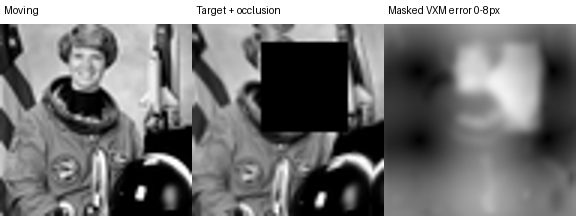

# Occlusion-aware image registration

Compare translation, optical flow and VoxelMorph when a moving photograph must be aligned to a partly hidden target. This is a **2D natural-photo experiment with known synthetic deformation**. The displayed error map comes from the held-out astronaut photograph.



```powershell
python -m pip install -r requirements.txt
python run.py demo --out scratch/demo
python run.py reproduce --out scratch/reproduction
python run.py evaluate --out results
python -m unittest discover -s tests
```

Use Python 3.11 and Git. CPU is sufficient. The demo loads the included masked checkpoint. Reproduction trains both VoxelMorph models from the same initialization, verifies exact checkpoint reload, writes dense predictions and reconstructs the tables. The evaluate command uses the saved predictions.

## Protocol

The pinned scikit-image wheel supplies the original photographs. Six source photographs are reserved for training. The three held-out photographs (astronaut, moon and rocket) each supply six seeded cases, giving 18 evaluated pairs. Crops from any one original stay in one split. We apply a known smooth backward deformation with translation and a rectangular occlusion to the target. The deformation truth is used only in evaluation. Training compares the warped moving photo to the target, with the same smoothness penalty, data order and 160 Adam updates of four pairs in both arms. One arm excludes the known occluded rectangle from its photometric loss. Predictions and land­marks use pixel units at 64 × 64. Source files and checksums are in [the manifest](results/data-sha256.json).

## Held-out results

| Method | Landmark TRE (px) | Visible EPE (px) | Occluded EPE (px) | Folded pixels |
|---|---:|---:|---:|---:|
| Identity | 3.292 | 3.351 | 3.107 | 0.00% |
| Phase-correlation translation | 3.249 | 3.224 | 3.351 | 0.00% |
| Farnebäck | 2.897 | 2.739 | 4.118 | 3.49% |
| VoxelMorph | 3.311 | 3.173 | 4.051 | 0.72% |
| VoxelMorph with occlusion mask | 3.233 | 3.184 | 3.513 | 0.01% |

Farnebäck had the lowest mean landmark error. Mask-weighted training reduced mean error inside occlusions relative to unmasked training, while identity had lower occluded EPE than either learned method. The test contains three original images and one training seed. The protocol uses known target masks and does not evaluate clinical data.

## Architecture and evidence

[Experiment code](src/experiment.py) adapts the upstream 2D `VxmPairwise` model, generates pairs, trains two variants, computes geometric baselines and reports landmark error and nonpositive Jacobian determinants. [Configuration](configs/experiment.json) fixes splits, seed and budget. [Per-case rows](results/cases.csv), [aggregate metrics](results/summary.csv) and [training losses](results/training.json) preserve unfavorable results as well. See [upstream](UPSTREAM.md) and [handoff](HANDOFF.md).
